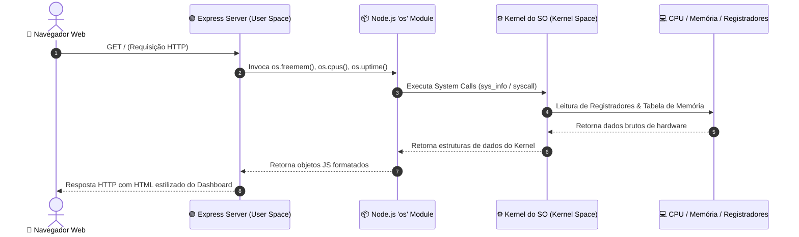
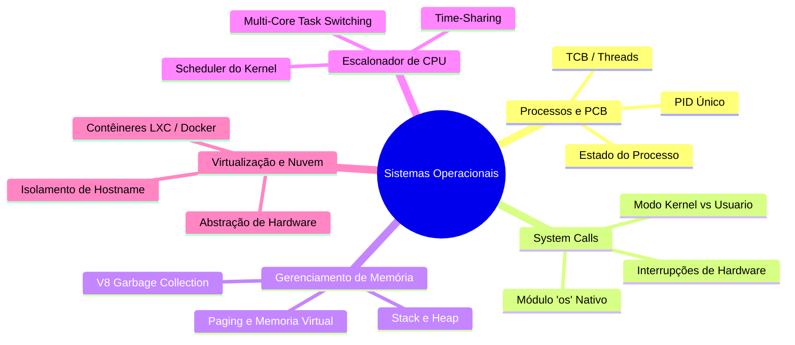

<div align="center">

# 💻 `cloud-so-app`

### 🚀 Painel de Monitoramento do Sistema Operacional & Hardware em Nuvem

[](https://nodejs.org/)
[](https://expressjs.com/)
[](https://cloud-so-app-jaque.onrender.com)
[](https://sistemas-operacionais-production.up.railway.app)
[](#)

<p align="center">
  <b>Aplicação Web para coleta, análise e monitoramento de métricas em tempo real do Sistema Operacional e Hardware.</b><br/>
  Estudo prático comparativo entre execução em máquina física local (Windows) e contêineres virtualizados na nuvem (Linux / PaaS).
</p>

[🌐 Acessar no Render](https://cloud-so-app-jaque.onrender.com) • [🚂 Acessar no Railway](https://sistemas-operacionais-production.up.railway.app) • [📖 Ver Manual Interno](./MANUAL.md)

---

</div>

## 📋 Sumário

- [1. 🎯 Sobre o Projeto](#1--sobre-o-projeto)
- [2. ✨ Funcionalidades Principais](#2--funcionalidades-principais)
- [3. 🛠️ Tecnologias & Módulos Nativos](#3️-tecnologias--módulos-nativos)
- [4. 🏗️ Arquitetura & Fluxo de Chamadas (System Calls)](#4️-arquitetura--fluxo-de-chamadas-system-calls)
- [5. 📂 Estrutura de Arquivos](#5--estrutura-de-arquivos)
- [6. 🚀 Como Executar Localmente](#6--como-executar-localmente)
- [7. ☁️ Implantação nas Plataformas PaaS](#7️-implantação-nas-plataformas-paas)
- [8. 📊 Análise Comparativa dos Ambientes](#8--análise-comparativa-dos-ambientes)
- [9. 🎓 Conceitos Teóricos de Sistemas Operacionais](#9--conceitos-teóricos-de-sistemas-operacionais)
- [10. 🔧 Solução de Problemas & Troubleshooting](#10--solução-de-problemas--troubleshooting)
- [11. 👩‍💻 Autora](#11--autora)

---

## 1. 🎯 Sobre o Projeto

O **`cloud-so-app`** é um painel web interativo construído em **Node.js** e **Express.js** que consulta a camada do Kernel do Sistema Operacional via chamadas nativas (`os` module) para expor relatórios em tempo real de hardware, uso de memória e tempo de atividade do sistema.

> [!NOTE]  
> **Objetivo Acadêmico:** Demonstrar na prática a abstração fornecida por **Sistemas Operacionais**, **Virtualização** e **Contêineres** ao comparar os recursos expostos em uma máquina física local (Windows 11) e em ambientes de nuvem multicore (Linux AWS no Render e Linux Docker no Railway).

---

## 2. ✨ Funcionalidades Principais

| Ícone | Funcionalidade | Descrição Técnica |
| :---: | :--- | :--- |
| 🏷️ | **Identificação do Host** | Captura do `hostname` físico ou do ID dinâmico do contêiner. |
| 🐧 | **Detecção de Plataforma** | Identificação do SO (`win32` vs `linux`), Kernel e arquitetura (`x64`). |
| ⚡ | **Mapeamento de CPU** | Contagem de núcleos virtuais e identificação do modelo do processador. |
| 🧠 | **Monitoramento de RAM** | Cálculo de memória total e livre em Gigabytes: $\text{RAM}_{\text{GB}} = \frac{\text{bytes}}{1024^3}$. |
| ⏱️ | **Uptime do Sistema** | Medição contínua do tempo de atividade acumulado pelo Kernel. |
| 📱 | **Interface Web Responsiva** | Dashboard estilizado renderizado diretamente no servidor (SSR). |

---

## 3. 🛠️ Tecnologias & Módulos Nativos

<div align="center">

| Tecnologia | Função no Ecossistema |
| :--- | :--- |
| **Node.js (v24.x)** | Ambiente de execução JavaScript do lado do servidor |
| **Express.js** | Framework HTTP para roteamento e servimento de HTML |
| **Node.js `os` Module** | Módulo nativo para chamadas diretas ao Kernel do SO |
| **Git / GitHub** | Versionamento de código e integração contínua (CI/CD) |
| **Render & Railway** | Provedores PaaS de nuvem para conteinerização automatizada |
| **Docker / LXC** | Tecnologia de isolamento de processos e virtualização leve |

</div>

---

## 4. 🏗️ Arquitetura & Fluxo de Chamadas (System Calls)

Abaixo é representado o fluxo de interrupções e chamadas de sistema (*System Calls*) desde a requisição HTTP do usuário no espaço de usuário (*User Space*) até o acesso direto aos dados mantidos no *Kernel Space*:



---

## 5. 📂 Estrutura de Arquivos

```text
cloud-so-app/
├── 📁 node_modules/         # Dependências instaladas (Express)
├── 📄 .gitignore           # Arquivos ignorados no versionamento Git
├── 📄 package.json         # Manifesto e scripts da aplicação Node.js
├── 📄 package-lock.json    # Lockfile de versões exatas das dependências
├── ⚡ server.js            # Ponto de entrada e servidor Express
├── 📖 MANUAL.md            # Manual completo de desenvolvimento e conceitos
├── 📊 Relatório_Atividade_07.md # Relatório descritivo de implantação em PaaS
├── 📝 README.md            # Documentação principal do repositório
├── 🖼️ metrica_jaque.jpg    # Evidência da execução local (Windows)
├── 🖼️ metrica_render.jpg   # Evidência das métricas na nuvem Render
├── 🖼️ tela_render.jpg      # Painel administrativo do Render
├── 🖼️ tela_projeto_railway.png # Painel de serviços do Railway
└── 🖼️ Captura..._railway.png  # Configurações de domínio e rede Railway
```

---

## 6. 🚀 Como Executar Localmente

> [!TIP]
> **Pré-requisitos:** Certifique-se de possuir o **Node.js** (v18+) e o **Git** instalados na sua máquina.

```bash
# 1. Clone o repositório para sua máquina local
git clone https://github.com/jaquellinef/cloud-so-app.git

# 2. Acesse a pasta do projeto
cd cloud-so-app

# 3. Instale as dependências do Express
npm install

# 4. Inicie o servidor Node.js
node server.js
```

Após iniciar, acesse no seu navegador: `http://localhost:3000` 🌐

---

## 7. ☁️ Implantação nas Plataformas PaaS

O projeto está implantado em múltiplos provedores de nuvem para comparar o comportamento da virtualização:

```mermaid
graph TD
    subgraph LOCAL["💻 Ambiente Local (Físico)"]
        W11["🪟 Windows 11 Home/Pro x64"]
        CPU1["12 Cores Intel i5-1235U"]
        RAM1["7.73 GB RAM Total"]
        APP1["Node.js (Porta 3000)"]
        W11 --> CPU1 & RAM1 --> APP1
    end

    subgraph RENDER["☁️ Render Cloud (PaaS)"]
        L1["🐧 Linux Server (AWS Kernel)"]
        CONT1["📦 Contêiner Isolado (LXC)"]
        CPU2["8 Cores AMD EPYC 7R13"]
        RAM2["30.65 GB RAM Total"]
        APP2["Node.js App (URL Pública)"]
        L1 --> CONT1 --> CPU2 & RAM2 --> APP2
    end

    subgraph RAILWAY["🚂 Railway Cloud (PaaS)"]
        L2["🐧 Linux Server (Host Docker)"]
        CONT2["📦 Contêiner Docker"]
        CPU3["48 Cores AMD EPYC 9655"]
        RAM3["322.69 GB RAM Total"]
        APP3["Node.js App (Porta 8080)"]
        L2 --> CONT2 --> CPU3 & RAM3 --> APP3
    end
```



---

## 8. 📊 Análise Comparativa dos Ambientes

A tabela abaixo resume os dados coletados ao vivo em cada ambiente de execução:

| Parâmetro / Métrica | 💻 Execução Local | ☁️ Render (Cloud PaaS) | 🚂 Railway (Cloud PaaS) |
| :--- | :---: | :---: | :---: |
| **Status do Serviço** | 🟢 Ativo (Local) | 🟢 Online (PaaS) | 🟢 Online (PaaS) |
| **Sistema Operacional** | `win32` (Windows 11) | `linux` (Linux AWS) | `linux` (Linux Docker) |
| **Arquitetura** | `x64` | `x64` | `x64` |
| **Hostname** | `Jaquelline` | `srv-daug...` / `srv-db2...` | `5f456ede1912` |
| **Modelo da CPU** | Intel Core i5-1235U | AMD EPYC 7R13 Processor | AMD EPYC 9655 96-Core |
| **Núcleos (vCPUs)** | 12 Núcleos | 8 vCPUs | **48 vCPUs** |
| **Memória RAM Total** | `7.73 GB` | `30.65 GB` | **`322.69 GB`** |
| **Memória RAM Livre** | `0.75 GB` (~10%) | `8.53 GB` a `11.86 GB` | `89.33 GB` |
| **Tempo de Atividade** | ~7 dias (173h) | **~159 dias (3816h)** | **~151 dias (3630h)** |

---

## 9. 🎓 Conceitos Teóricos de Sistemas Operacionais

O desenvolvimento e implantação do `cloud-so-app` permitiram aplicar na prática os **5 pilares de Sistemas Operacionais**:



> [!IMPORTANT]
> 1. **Bloco de Controle de Processo (PCB/TCB):** O Node.js executa como um processo no *User Space* identificado por um PID único. O Kernel do SO associa a ele um PCB para controlar registradores, contexto e consumo de memória.
> 2. **Chamadas de Sistema (*System Calls*):** Funções como `os.freemem()` acionam interrupções de software que alternam a execução do modo usuário para o modo Kernel para ler a tabela de memória do SO.
> 3. **Gerenciamento de Memória & V8 GC:** No runtime Node.js, a Engine V8 administra dynamic memory (*Heap*) acionando o *Garbage Collector* periodicamente.
> 4. **Escalonamento de CPU (*Scheduler*):** O escalonador do SO distribui os threads da aplicação entre os núcleos físicos/virtuais (12 núcleos locais vs 48 núcleos na nuvem).
> 5. **Virtualização & Conteinerização:** Nos ambientes Render e Railway, a aplicação é isolada dentro de contêineres. O *hostname* exposto é o ID do contêiner e o hardware reportado pertence ao nó do cluster do provedor de nuvem.

---

## 10. 🔧 Solução de Problemas & Troubleshooting

<details>
<summary><b>1. Erro de Extensão de Arquivo (<code>MODULE_NOT_FOUND</code>)</b></summary>

* **Sintoma:** Ao rodar `node server.js`, o Node informava que não encontrava o arquivo.
* **Causa:** O Windows ocultava extensões e salvou o arquivo como `server.js.txt`.
* **Solução:** Ativação da exibição de extensões no Explorer e renomeação direta para `server.js`.
</details>

<details>
<summary><b>2. Erro de Envio Git (<code>GH007: Private Email Address</code>)</b></summary>

* **Sintoma:** O comando `git push` falhava ao enviar commits para o GitHub.
* **Causa:** Bloqueio ativado na conta do GitHub para ocultar endereço de e-mail pessoal.
* **Solução:** Ajuste nas configurações de e-mail do GitHub (`settings/emails`) autorizando o envio seguro.
</details>

---

## 11. 👩‍💻 Autora

<div align="center">

| Desenvolvedora | Repositório | Status do Projeto |
| :---: | :---: | :---: |
| **Jaquelline** ([@jaquellinef](https://github.com/jaquellinef)) | [`cloud-so-app`](https://github.com/jaquellinef/cloud-so-app) | 🟢 Concluído & Publicado |

---

*Desenvolvido como projeto prático de Sistemas Operacionais.*  
*Se este repositório foi útil para você, deixe uma ⭐!*

</div>
